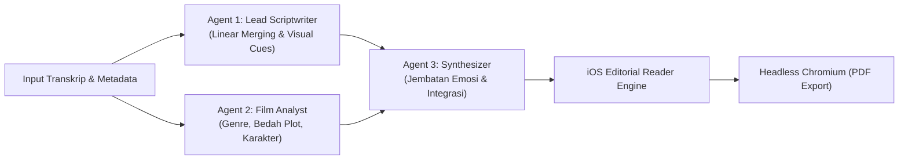
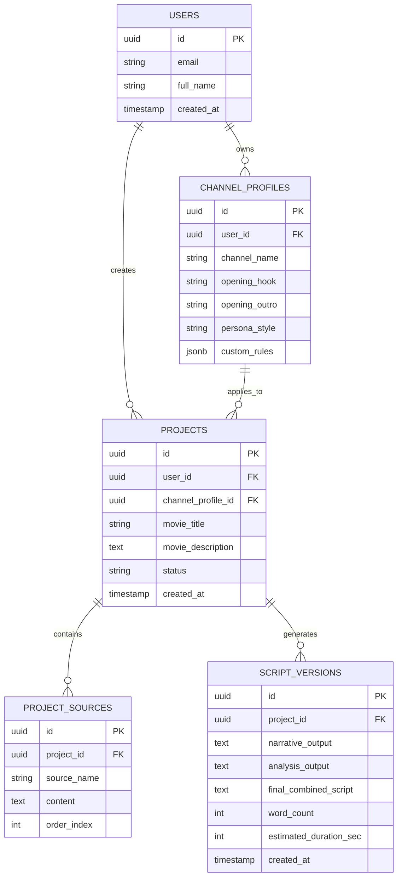
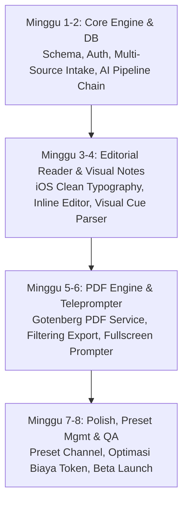

# PRD: AlurCerita Studio (AI-Powered Movie Recap Script Studio)

---

## 1. TL;DR
**AlurCerita Studio** adalah platform berbasis web untuk kreator konten YouTube/TikTok "Alur Cerita Film" yang mengotomatisasi penggabungan multi-sumber transkrip/sinopsis menjadi naskah recap film siap rekam (voiceover-ready) dan siap edit (editor-ready). Aplikasi ini mengorkestrasi pipeline multi-agent AI (Penggabung Cerita + Analis Film + Synthesizer) yang menyisipkan *visual cues* otomatis, membedah pesan moral dan karakter, serta menyediakan *live script reader* bergaya editorial iOS dengan fitur ekspor instan ke PDF/HTML.

---

## 2. Goals

### Business Goals
1. **Efisiensi Waktu Produksi**: Menekan durasi penulisan naskah alur cerita dari rata-rata **4–6 jam** (manual cross-referencing & drafting) menjadi **kurang dari 3 menit**.
2. **Kualitas Retensi Penonton (Audience Retention)**: Menghasilkan naskah dengan struktur dramatik teruji (hook emosional, pacing dinamis, transisi halus) guna meningkatkan retensi rata-rata video di atas 45%.
3. **Standarisasi Alur Kerja Tim (Creator-to-Editor Handoff)**: Mengurangi revisi antara penulis naskah, voiceover artist, dan video editor hingga 80% berkat format visual cues `(Visual: [Deskripsi])` yang baku.
4. **Adopsi & Retensi MVP**: Mencapai 75% weekly active usage dari kreator alur cerita yang terdaftar dalam 60 hari pertama.

### User Goals
1. **Multi-Source Ingestion**: Pengguna dapat memasukkan 2–5 sumber teks sekaligus (transkrip YouTube kompetitor, subtitle, sinopsis IMDb, atau catatan pribadi) tanpa khawatir ada plot hole atau adegan terputus.
2. **Channel Identity Customization**: Pengguna dapat menyimpan template profil channel (sapaan unik seperti *"Halo Nakama"* / *"Halo Malas People"*, gaya bahasa "Gua-Lu" santai, outro khas) agar tone of voice konsisten.
3. **Deep Story Analysis**: Pengguna mendapatkan bedah film instan (analisis genre, bedah plot twist/pesan moral, perkembangan sifat/busur karakter) yang disisipkan natural sebelum kesimpulan.
4. **Distraction-Free Script Reader & Teleprompter**: Pengguna dapat membaca naskah dengan nyaman di desktop, tablet, maupun smartphone dengan pembeda visual yang jelas antara teks voiceover dan arahan editor.
5. **Instant One-Click Export**: Pengguna dapat mencetak naskah bersih ke format PDF siap pakai atau menyalinnya dalam sekali klik.

### Non-Goals
1. **Tidak Melakukan Auto-Video Rendering / Video Editing**: Aplikasi tidak merender klip video atau mengunduh footage film secara otomatis pada rilis MVP.
2. **Tidak Melakukan Text-to-Speech (TTS) Bawaan**: Fokus utama MVP adalah *scriptwriting intelligence* dan *editorial experience*; integrasi suara AI (ElevenLabs, dll.) masuk ke roadmap pasca-MVP.
3. **Tidak Menjadi CMS Multi-Channel Umum**: Aplikasi dioptimalkan secara spesifik untuk niche alur cerita/recap film, bukan generator artikel SEO atau blog post umum.

---

## 3. User Stories

### Persona 1: Reza (26) – Solo YouTube Creator ("AAAlur Cerita")
* **Profil**: Mengelola channel alur cerita film sendiri. Menulis naskah malam hari, rekam voiceover pagi hari. Sering lelah merangkum beberapa video referensi secara manual.
* **User Stories**:
  * *Sebagai kreator solo*, saya ingin memasukkan 3 link transkrip/teks referensi sekaligus, *agar* AI menggabungkan adegan yang paling detail tanpa ada bagian cerita yang bolong.
  * *Sebagai kreator solo*, saya ingin tone bahasa langsung cocok dengan persona channel saya ("Lo-Gue santai ala teman ngopi"), *agar* saya tidak perlu membuang waktu mengedit ulang kosakata naskah.
  * *Sebagai voiceover artist mandiri*, saya ingin membaca naskah di HP/tablet dengan mode pembaca yang bersih dan visual note yang terpisah jelas, *agar* saya tidak salah membaca instruksi editor sebagai kalimat narasi.

### Persona 2: Bayu (31) – Head of Production Studio Alur Cerita
* **Profil**: Memimpin tim dengan 3 scriptwriter dan 4 video editor freelance. Butuh format seragam dan kecepatan handover.
* **User Stories**:
  * *Sebagai head of production*, saya ingin naskah otomatis memiliki label `(Visual: [Deskripsi Adegan])` di setiap perpindahan adegan, *agar* video editor langsung paham potongan klip mana yang harus ditaruh di timeline Premiere Pro.
  * *Sebagai head of production*, saya ingin mengekspor naskah ke PDF berformat rapi dengan sekali klik, *agar* mudah dibagikan ke tim tanpa format berantakan.
  * *Sebagai head of production*, saya ingin menyimpan beberapa preset profil channel, *agar* tim bisa berganti gaya penulisan untuk 3 channel berbeda dalam satu dashboard.

### Persona 3: Doni (23) – Video Editor Freelance
* **Profil**: Menerima naskah alur cerita dari klien. Sering pusing jika naskah hanya berisi teks polos tanpa panduan visual.
* **User Stories**:
  * *Sebagai video editor*, saya ingin melihat penanda adegan film dengan detail ekspresi dan aksi, *agar* proses pencarian footage (B-roll & cutscenes) 3x lebih cepat.
  * *Sebagai video editor*, saya ingin naskah memiliki pembagian PART yang teratur, *agar* saya bisa membagi sequence editing per babak cerita.

---

## 4. Requirements & Core Logic

### Architecture Pipeline (Multi-Agent Engine)
Aplikasi mengadopsi pipeline 3-tahap (sebagaimana terbukti stabil pada prototipe n8n):



### Functional Requirements

#### Module 1: Ingestion & Metadata Workspace (High Priority)
* **FR-1.1 (Multi-Source Input)**: Menyediakan tab dinamis untuk memasukkan Sumber 1, 2, 3 (dan opsi tambah hingga Sumber 5) berupa raw text / transcript paste.
* **FR-1.2 (Movie Metadata Fetcher & Manual Fallback)**:
  * Input Nama Film.
  * Integrasi opsi pencarian metadata otomatis via TMDB/IMDb API (Sinopsis resmi, sutradara, aktor, karakter, genre, trivia, durasi).
  * Field manual "Deskripsi Film" jika film bersifat lokal/indie/sulit terindeks API.
* **FR-1.3 (Channel Identity Preset)**:
  * Channel Name (e.g. `AAAlur Cerita`).
  * Opening Hook Greeting (e.g. `Halo Nakama`, `Halo Malas People`).
  * Opening Outro Bridge (e.g. `Jadi, gak perlu cacicu lagi, langsung aja masuk ke ceritanya`).
  * Persona Selector (`Santai Lo-Gue`, `Semi-Formal Cerita Misteri`, `Komedi Sarkastik Halus`).
  * Ability to save and switch channel presets with 1 click.

#### Module 2: AI Orchestration & Script Generation (High Priority)
* **FR-2.1 (Stage 1 - Linear Narrative Merger)**:
  * Membandingkan data antar sumber: ambil detail terkaya pada tiap scene.
  * Menghilangkan kontradiksi logika/alur cerita.
  * Menjaga kronologi linear cerita dari awal sampai akhir film.
  * Menyisipkan `(Visual: [Deskripsi adegan detail])` secara mandatori pada setiap pergantian adegan atau pergeseran mood.
* **FR-2.2 (Stage 2 - Deep Film Analysis)**:
  * Membedah 3 segmen inti:
    1. *Kenapa Film Ini Seru?* (Genre, premis, daya pikat penonton umum).
    2. *Bedah Rencana & Pesan Film* (Penyelesaian masalah akhir, apakah plot masuk akal, hikmah moral).
    3. *Analisis Sifat Karakter* (Motivasi, kerapuhan/tragedi masa lalu, busur perubahan karakter).
  * Larangan keras penggunaan buzzword sok intelek yang tidak kontekstual (e.g. *Chef's kiss*, *stakes*, *arc*) — wajib menggunakan istilah santai yang dipahami penonton umum.
* **FR-2.3 (Stage 3 - Seamless Integration & Bridge)**:
  * Menggabungkan Narasi Cerita dan Analisis Film menjadi satu kesatuan utuh.
  * Menyisipkan paragraf jembatan emosi tepat sebelum kesimpulan (misal: *"Gimana? Ceritanya gokil kan? Tapi tunggu dulu, sebenernya ada hal yang lebih dalam yang mungkin lu lewatin..."*).
  * Menyusun output akhir berstruktur:
    1. `[JUDUL & GENRE]`
    2. `[OPENING]` (Sapaan, Hook, Premis Singkat)
    3. `[BODY STORY - PART 1..N]` (Narasi mengalir + Visual cues)
    4. `[ANALISIS FILM & KARAKTER]` (Bedah cerita & psikologi)
    5. `[KESIMPULAN & CLOSING]` (Review personal, moral story, call-to-action khas channel).

#### Module 3: Live Reader & Editorial Workspace (High Priority)
* **FR-3.1 (iOS-Clean Typography Reader)**:
  * Tampilan kertas naskah bersih (`#FFFFFF` di atas canvas lembut `#F2F2F7`).
  * Font Apple System Typography (`SF Pro Text` / `-apple-system`) dengan line-height lega (1.65).
  * Visual Cue Styling Khusus: Blok `(Visual: ...)` otomatis dirender menjadi *callout card* beraksen garis vertikal biru iOS (`#007AFF`), background abu-abu lembut (`#F9F9F9`), font italic, agar mata pembaca voiceover tidak tersandung.
* **FR-3.2 (Inline Edit & Live Word Count)**:
  * Pengguna dapat mengklik dan mengedit teks naskah secara langsung (*wysiwyg / inline contenteditable*).
  * Penghitung jumlah kata (*word count*) dan estimasi durasi pembacaan voiceover otomatis (rasio standar 130–150 kata per menit).
* **FR-3.3 (Teleprompter / Voiceover Mode)**:
  * Mode layar penuh (full screen) dengan ukuran font yang bisa diperbesar (18px – 32px), mode auto-scroll kecepatan fleksibel, dan toggle untuk menyembunyikan/menampilkan *Visual Cues* saat proses take vokal.

#### Module 4: Export Engine & Document Formatting (High Priority)
* **FR-4.1 (One-Click Copy)**:
  * Salin Naskah Utuh (Markdown / Plain Text).
  * Salin Khusus Voiceover (otomatis memfilter dan menghapus semua tag `(Visual: ...)`).
  * Salin Khusus Video Editor (hanya mengekstrak daftar urutan `Visual Cues` beserta timestamp/part).
* **FR-4.2 (High-Fidelity PDF Generation)**:
  * Ekspor PDF melalui engine Chromium (Gotenberg / Puppeteer API).
  * Layout dokumen PDF standar cetak (A4, margin teratur, penomoran halaman otomatis, header judul film, styling iOS-clean yang dipertahankan utuh).
* **FR-4.3 (HTML Bundle Export)**:
  * Mengunduh file `index.html` standalone mandiri tanpa dependensi luar yang dapat dibuka offline di browser apa pun.

---

## 5. User Experience & UI Anti-Slop Specification

### UI Anti-Slop Directive (Rule Compliance)

> [!IMPORTANT]
> **Design Thesis AlurCerita Studio**:
> *"Untuk content creator alur cerita film yang butuh naskah padat & siap rekam, UI ini terasa seperti meja kerja editorial yang tenang, presisi, dan fungsional, dengan signature dual-pane workflow yang membedakan secara tegas antara panel input referensi di kiri dan live visual-cue script reader di kanan."*

#### Token & Visual System
* **Anti-Slop Guarantees**:
  * **No generic purple-blue AI gradient**: Gunakan background netral slate/warm-gray (`#F8F9FA` canvas, `#FFFFFF` container cards).
  * **Accent Color**: Single primary action accent: Slate Blue (`#2563EB`) atau Editorial Amber (`#D97706`).
  * **Typography**: Maksimal 2 font: Inter / SF Pro Display untuk UI & body text, JetBrains Mono untuk tag metadata & visual cues.
  * **Border Radius**: Konsisten skala 6px / 10px / 14px (tidak serba bulat 28px/pill).
  * **Motion**: Transisi cepat (150ms–200ms ease-out) untuk tab switching & modal. Menghormati `prefers-reduced-motion`.
  * **Accessibility**: Kontras rasio teks WCAG AA minimal 5:1. Teks visual cue memakai `#3A3A3C` di atas `#F4F4F5`, bukan abu-abu pudar.

#### Component States
Setiap komponen interaktif wajib memiliki 7 state eksplisit:
1. `Default`
2. `Hover`
3. `Focus-Visible` (Ring outline 2px dengan offset jelas untuk navigasi keyboard)
4. `Active/Press`
5. `Disabled`
6. `Loading/Generating` (Indikator progres pipeline multi-agent: Agent 1 ➔ Agent 2 ➔ Agent 3)
7. `Error State` (Pesan kesalahan spesifik dengan tombol retry tanpa menghilangkan input teks sebelumnya).

### User Flow Steps
1. **Langkah 1: Input & Context**
   * Pengguna membuka workspace. Panel kiri menampilkan tab `Sumber A`, `Sumber B`, `Sumber C`. Pengguna menempelkan teks atau transkrip.
   * Memilih profil channel (contoh: *AAAlur Cerita - Halo Nakama - Lo Gue Santai*).
   * Klik tombol **"Generate Naskah Utuh"**.
2. **Langkah 2: Multi-Agent Processing**
   * Tampil *Progress Tracker* transparan:
     - 🟢 *Menyelaraskan kronologi 3 sumber data...*
     - 🟡 *Menyusun analisis genre, plot twist & karakter...*
     - 🔵 *Menyempurnakan jembatan emosi & visual cues...*
3. **Langkah 3: Review & Edit di iOS Reader**
   * Naskah langsung muncul di panel kanan dalam format iOS Reader.
   * `(Visual: [Deskripsi])` tersorot jelas sebagai kartu terpisah.
   * Pengguna dapat mengedit kata langsung jika ada nama orang/lokasi yang perlu disesuaikan.
4. **Langkah 4: Record & Export**
   * Klik **"Buka Teleprompter"** untuk mulai rekam suara.
   * Atau klik **"Download PDF"** untuk dikirim ke editor video melalui WhatsApp/Google Drive.

---

## 6. Narrative: A Day in the Life of a Creator

Sore hari pukul 16:30, Dimas ingin membuat video recap film klasik *"The Karate Kid (2010)"*. Di internet, ada 3 transkrip recap dari channel berbeda, namun masing-masing punya kekurangan: Channel A melewatkan detail kecelakaan mobil Mr. Han, Channel B salah menyebutkan nama jurus ular, dan Channel C tidak membahas motif guru silat lawan yang kejam.

Dulu, Dimas harus membuka 3 tab Notepad, membaca bergantian, dan mengetik ulang dari nol selama 4 jam penuh.

Sekarang, dengan **AlurCerita Studio**:
1. Dimas menempelkan teks dari ketiga channel tersebut ke tab Sumber A, B, dan C.
2. Dimas memilih profil channelnya: *"AAAlur Cerita"*.
3. Dalam 45 detik, naskah utuh sepanjang 3.500 kata tersusun rapi:
   - Cerita mengalir linear tanpa ada adegan yang terpotong.
   - Bagian emosional saat Mr. Han membetulkan mobil lalu menghancurkannya dibahas dengan mendalam.
   - Analisis film terselip mulus sebelum kesimpulan dengan gaya bahasa santai *"Lo-Gue"*.
   - Setiap 3 kalimat terdapat petunjuk `(Visual: Dre mengelap keringat dengan kuda-kuda ular)` untuk editornya.
4. Dimas menekan tombol **"Export PDF"**, mengirim filenya ke video editor, lalu mengaktifkan **"Teleprompter Mode"** di iPad-nya untuk mulai take suara. Tepat pukul 17:00, seluruh materi vokal selesai diproduksi.

---

## 7. Metrics & Analytics

### User-Centric Metrics
* **Time-to-Script**: Waktu dari klik "Generate" sampai naskah selesai ditampilkan di bawah 60 detik.
* **Edit Distance Rate**: Persentase perubahan teks manual yang dilakukan pengguna setelah AI selesai generate di bawah 15% (menandakan kualitas naskah langsung usable).
* **Export Completion Rate**: Lebih dari 85% naskah yang digenerate berhasil diekspor (PDF/Copy/Teleprompter).

### Business & Operational Metrics
* **Cost per Script Generation**: Rata-rata biaya token LLM di bawah \$0.04 per naskah lengkap (dengan optimasi prompt & model tiering).
* **Retention**: 40% Monthly Active Retention pada kreator aktif di bulan ke-3.
* **Generation Success Rate**: 99.5% run tanpa timeout atau error API LLM.

### Tracking Events
* `project_created`
* `sources_pasted` (count of sources: 1, 2, or 3+)
* `channel_preset_applied`
* `generation_started`
* `generation_agent_stage_completed` (stage: 1, 2, 3)
* `script_inline_edited`
* `teleprompter_mode_opened`
* `pdf_exported`
* `copy_clean_voiceover_clicked`

---

## 8. Technical Architecture & Data Model

### Tech Stack Recommendation
* **Frontend**: Next.js 15 (App Router) / React 19 + Tailwind CSS + Lucide Icons.
* **Typography & Reader Engine**: Custom CSS iOS SF Pro Design Token, TipTap editor (headless WYSIWYG) untuk inline editing yang stabil.
* **LLM Layer**: Vercel AI SDK dengan model routing (Google Gemini 1.5 Pro / Flash untuk konteks panjang multi-transkrip yang murah dan presisi).
* **PDF Rendering Service**: Gotenberg (Chromium Headless Docker container) atau Puppeteer endpoint internal untuk konversi HTML-to-PDF pixel-perfect.
* **Database & Cache**: PostgreSQL (Supabase / Neon) + Drizzle ORM; Upstash Redis untuk caching metadata film & rate limiting.

### Database Schema (ERD Overview)



### Data Privacy & Performance Considerations
* **Penyimpanan Transkrip**: Data sumber dan naskah diisolasi per `user_id` dengan Row-Level Security (RLS).
* **Token Window Management**: Karena transkrip alur cerita film bisa mencapai 10.000–25.000 kata total (dari 3 sumber), arsitektur wajib menggunakan LLM dengan *long-context window* (minimal 128k context) seperti Google Gemini tanpa pemotongan chunk sembarangan yang bisa merusak kontinuitas plot.
* **Streaming Responses**: Menggunakan SSE (Server-Sent Events) agar pengguna dapat melihat naskah ditulis secara realtime tanpa menunggu timeout HTTP 60 detik.

---

## 9. Milestones & Timeline (8-Week Execution)



* **Sprint 1 (Minggu 1–2): Multi-Agent Pipeline & Data Model**
  * Setup Next.js, Auth, PostgreSQL (Drizzle ORM).
  * Implementasi 3-Stage Prompting Pipeline menggunakan Gemini via AI SDK.
* **Sprint 2 (Minggu 3–4): Editorial iOS Reader & WYSIWYG**
  * Tampilan Dual-Pane Workspace (Input Kiri, Script Reader Kanan).
  * Parser otomatis tag `(Visual: ...)` menjadi kartu visual styling iOS.
  * Inline editing naskah dan penghitung durasi kata.
* **Sprint 3 (Minggu 5–6): Export Suite & Teleprompter**
  * Integrasi Docker Gotenberg untuk konversi HTML ➔ PDF berkualitas tinggi.
  * Fitur 1-click copy (Naskah Bersih Voiceover vs Naskah Lengkap Editor).
  * Fullscreen Teleprompter dengan auto-scroll.
* **Sprint 4 (Minggu 7–8): Channel Presets, Hardening & Launch**
  * Manajemen Profil Preset Channel.
  * Error boundary handling & token optimization.
  * Uji coba ke 10 kreator komunitas alur cerita.

---

## 10. Prompt Generation (AI-Ready Prompt for Cursor / Bolt / v0)

Gunakan prompt di bawah ini untuk langsung membuat aplikasi ini di Cursor, Lovable, Bolt.new, atau IDE agen koding Anda:

```markdown
Build a production-ready Web Application called "AlurCerita Studio" designed for YouTube & TikTok Movie Recap creators.

Core Concept:
An AI-powered editorial studio that takes 2 to 3 raw movie recap transcripts/sources, combines them into one seamless chronological narrative script without plot holes, generates an in-depth film & character psychology analysis, integrates them with natural conversational bridges, and renders the result in a clean iOS-style reading experience with visual cues for video editors.

Key Features & Screens:
1. Workspace (Dual-Pane Layout):
   - Left Pane (Drawer/Resizable):
     - Source Tabs: 'Sumber A', 'Sumber B', 'Sumber C' (Textareas with paste & word counter).
     - Movie Metadata: Film Title, Director/Year, and Movie Description (synopsis/IMDb overview).
     - Channel Persona Presets: Channel Name (e.g., 'AAAlur Cerita'), Opening Greeting ('Halo Nakama'), Outro Bridge, and Persona ('Lo-Gue santai ala teman ngopi, no cringe slang').
     - Action Button: 'Generate Naskah Utuh' with multi-stage progress indicator.
   - Right Pane (Live Editorial Reader):
     - iOS-inspired paper container (#FFFFFF on #F2F2F7 background, SF Pro typography).
     - Automatic parsing of '(Visual: [Scene description])' into distinct, styled callout blocks (light gray background, 4px solid blue left border, italic, distinct from spoken narration).
     - Inline editable text with real-time word count and estimated voiceover reading time (at 140 wpm).
     - Quick Action Bar: 'Salin Naskah Utuh', 'Salin Voiceover Bersih (Hapus Visual Cues)', 'Teleprompter Mode', and 'Export PDF'.

2. AI Orchestration Pipeline (Next.js API Route with LangChain / AI SDK):
   - Step 1 (Lead Scriptwriter Agent): Compares Sources A, B, and C. Selects the richest details, ensures chronological narrative, explains character motivations ('Why'), and strictly injects '(Visual: [Detail])' on every scene transition.
   - Step 2 (Film Analyst Agent): Evaluates the film under 3 sections: 'Kenapa Film Ini Seru' (Genre & Hook), 'Bedah Rencana & Pesan Film' (Plot resolution & moral lesson), and 'Analisis Sifat Karakter' (Character growth & flaws).
   - Step 3 (Synthesizer Agent): Merges Narrative + Analysis with an engaging emotional bridge right before the closing segment.

3. Teleprompter Mode:
   - Fullscreen distraction-free overlay, adjustable font size (18-36px), toggleable visual notes, and customizable auto-scroll speed.

4. Exporting:
   - Client-side or API endpoint for HTML-to-PDF rendering using clean print stylesheets matching the iOS theme.

Design System (UI Anti-Slop Directive):
- Content-first editorial aesthetic. No generic purple AI gradients or glassmorphism.
- Consistent neutral palette with Slate Blue (#007AFF) accents.
- Full states for all controls: default, hover, focus-visible, active, disabled, streaming-loading, and error states.
- Clean typography hierarchy and accessible WCAG AA contrast.
```
